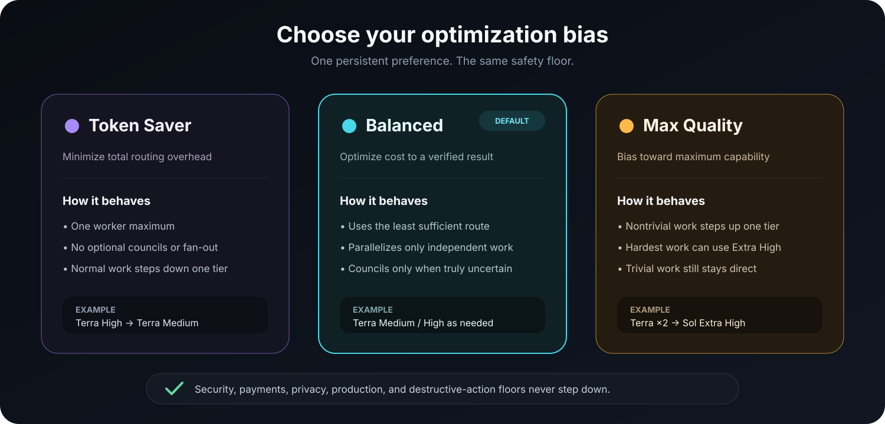

<p align="center">
  
</p>

<p align="center">
  <a href="https://github.com/vibeforge1111/Codex-Autorouter/actions/workflows/ci.yml"></a>
  
  <a href="LICENSE"></a>
  
</p>

<p align="center">
  <strong>Automatic model, effort, and subagent routing for Codex.</strong><br>
  Spend tokens where they improve the result—not everywhere by default.
</p>

---

## Why Codex Autorouter

Codex Autorouter profiles each task, chooses the least expensive GPT-5.6 route likely to produce a verified result, and enforces a proportionate completion gate. It can keep work in the current agent or delegate a bounded unit to Luna, Terra, or Sol with the right configured reasoning effort.

| Work shape | Typical route | Why |
|---|---|---|
| Tiny, single-path task | Current agent | Avoid model-switch overhead |
| Repetitive and objectively checked | Luna Low | Cheap, bounded execution |
| Ordinary implementation or exploration | Terra Medium | Strong cost-to-capability ratio |
| Ambiguous debugging or edge cases | Terra High | More reasoning without jumping tiers |
| Architecture, migration, demanding synthesis | Sol Medium | End-to-end ownership |
| Difficult security or consequential work | Sol High | Deep specialist execution |
| Hardest long-running work in Max Quality | Sol Extra High | Extra depth only when worth the cost |

The router understands product strategy, requirements, UX, frontend, backend, data, mobile, AI, integrations, payments, QA, analytics, growth, accessibility, localization, DevOps, reliability, security, privacy, performance, and maintenance.

## Three routing profiles

<p align="center">
  
</p>

Set a persistent preference from the installed plugin directory:

```bash
python3 skills/route-gpt-5-6-work/scripts/routerctl.py profile token-saver
python3 skills/route-gpt-5-6-work/scripts/routerctl.py profile balanced
python3 skills/route-gpt-5-6-work/scripts/routerctl.py profile max-quality
```

Inspect the active preference with:

```bash
python3 skills/route-gpt-5-6-work/scripts/routerctl.py profile
```

The preference survives plugin upgrades and applies to the next new task. Fast/Standard remains a separate Codex setting: the router inherits it and never silently toggles it.

## How it works

<p align="center">
  
</p>

1. **Profile** the task from trusted user intent: risk, ambiguity, volume, mutation scope, verification strength, and safe parallelism.
2. **Select** a model, reasoning effort, and one bounded orchestration plan.
3. **Execute** in the current agent or through depth-1 custom agents; never recursive fan-out.
4. **Verify** after the final mutation with the cheapest relevant deterministic evidence.
5. **Route up once** only when a worker returns evidence of a real capability limit.

Public route labels stay factual: `Terra High Standard`, `Sol Extra High Fast`, or `Luna Low Speed unknown`. Internal role IDs stay out of normal user-facing copy.

## Install

### Marketplace plugin — full routing and hooks

Install from the marketplace that distributes the plugin, then start a fresh Codex task. Record the **Installed plugin root** printed by Codex and run these commands there:

```bash
codex plugin add gpt-5-6-router@<marketplace>

python3 skills/route-gpt-5-6-work/scripts/routerctl.py status
python3 skills/route-gpt-5-6-work/scripts/routerctl.py activate
python3 scripts/check_hooks.py
```

Open `/hooks` in Codex and review the five lifecycle hooks before trusting them. Plugin installation does not imply hook trust. Python 3.10 or newer is required.

### GitHub archive — standalone advisory mode

Codex IDE extensions do not currently support plugins. A release archive can instead install the conflict-safe advisory skill:

```bash
python3 scripts/standalonectl.py status
python3 scripts/standalonectl.py install
```

Standalone mode deliberately does not pretend to have plugin-hook enforcement. See [standalone installation](docs/STANDALONE.md) and [known limitations](docs/LIMITATIONS.md).

## Safety by design

- **Stable package identity:** the GitHub project is Codex Autorouter; the installed plugin ID remains `gpt-5-6-router` so upgrades do not strand existing users.
- **Bounded delegation:** maximum depth 1 and maximum three agents.
- **Protected floors:** Token Saver never discounts security, payments, privacy, production, destructive actions, or other high-risk work.
- **No silent speed changes:** Fast/Standard is inherited, not selected by the router.
- **Post-mutation verification:** earlier checks cannot satisfy the completion gate.
- **Non-recursive completion:** verification feedback can continue a turn once; terminal and duplicate Stop events cannot reinject the same gate.
- **Upgrade-resilient hooks:** tasks created by this build can locate the newest installed router after their original immutable cache is replaced.
- **Conflict-safe activation:** only six namespaced agent files are managed, with checksums, atomic replacement, rollback, crash recovery, and automatic migration from the private-beta role set.
- **Prompt privacy:** routing ledgers contain no prompt content or prompt-derived hashes.

## Readiness is reported honestly

| State | Meaning |
|---|---|
| `ADVISORY` | The skill can advise or work in the current agent; full enforcement is not proven. |
| `ADVISORY` + `local_agent_ready: true` | Agent definitions are current, but filesystem state alone cannot attest hook discovery. |
| `scripts/check_hooks.py` ready | App-server discovery, trusted hooks, and current agent files match this build. |
| `MANAGED_BLOCKED` | Organization policy permits only managed hooks. The router does not bypass it. |

A successful non-current live ledger with matching lifecycle attestation remains the final proof that the launcher selected the named custom agent.

> **Release status:** the automated matrix passes on macOS, Ubuntu, and Windows across Python 3.10–3.14. Broad public-stable release still requires the remaining real-host acceptance rows and a tested private vulnerability-reporting channel. See [release evidence](docs/RELEASE_EVIDENCE.md).

## Documentation

| Guide | Use it for |
|---|---|
| [Installation and lifecycle](docs/INSTALL.md) | Plugin install, activation, upgrade, repair, and uninstall |
| [Standalone advisory mode](docs/STANDALONE.md) | GitHub archive and IDE-compatible installation |
| [Known limitations](docs/LIMITATIONS.md) | Runtime, hooks, Fast, and custom-agent boundaries |
| [Privacy](docs/PRIVACY.md) | Local preference and ledger contents |
| [Troubleshooting](docs/TROUBLESHOOTING.md) | Readiness, trust, recovery, and routing-profile issues |
| [Release checklist](docs/RELEASE_CHECKLIST.md) | Automated and real-host launch gates |
| [Release evidence](docs/RELEASE_EVIDENCE.md) | Candidate-specific validation proof |

## Development

```bash
python3 scripts/validate_release.py
python3 scripts/fuzz_router.py

cd skills/route-gpt-5-6-work/scripts
python3 -m unittest -v test_router test_routerctl
```

The current suite covers 164 routing and lifecycle tests plus 5,000 deterministic fuzz cases per CI job, including all three profiles, Extra High selection, stale-cache migration, Stop idempotency, legacy-role migration, lifecycle ownership, concurrency, crash recovery, hook readiness, and clean-room standalone installation.

## License

[MIT](LICENSE)
