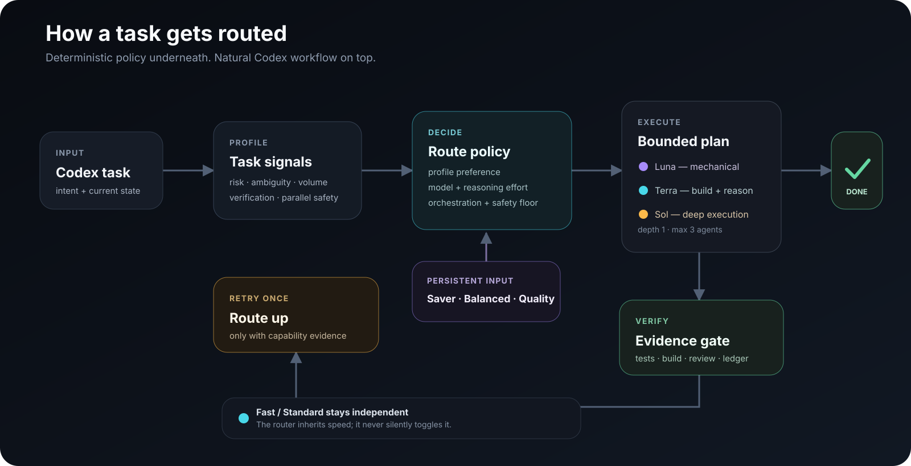

<p align="center">
  
</p>

<p align="center">
  <a href="https://github.com/anthonypaddison/Codex-Autorouter/actions/workflows/ci.yml"></a>
  
  <a href="LICENSE"></a>
  
</p>

<p align="center">
  <strong>Select Luna once, then use Codex normally.</strong><br>
  Autorouter keeps routine work on the active root and escalates bounded work only when warranted.
</p>

---

## Start here

Autorouter is designed around a cheap GPT-6 Luna root. Describe what you want built, fixed, researched, or reviewed; the active root remains authoritative for the turn and Autorouter escalates only when the task warrants it.

### What you need

- Codex Desktop or Codex CLI
- Python 3.10 or newer
- Access to this GitHub repository during the private beta

### 1. Select Luna once

In Codex Desktop, select **GPT-6 Luna** as the model before starting a new task. For a personal CLI default, use these top-level entries in your Codex `config.toml`:

```toml
model = "gpt-6-luna"
model_reasoning_effort = "low"
```

`low` is the preferred initial effort, not an architectural requirement. If a later controlled acceptance test shows that Luna Low is unreliable at following routing instructions, creating bounded child contracts, or synthesising escalated results, compare Luna Low with Luna Medium before changing the recommendation.

This is a one-time user selection. Autorouter does not configure Luna, does not silently modify the root model, and none of its install, update, activate, deactivate, or remove operations changes global/root Codex configuration.

### 2. Install the reviewed release

Version `v0.2.0` is the planned immutable release reference. The tag does not exist merely because it appears in this candidate's metadata; use the commands below only after the reviewed tag has been created by the release procedure:

```bash
codex plugin marketplace add anthonypaddison/Codex-Autorouter --ref v0.2.0
codex plugin add gpt-5-6-router@codex-autorouter
```

The second command prints an **Installed plugin root**. Copy that path for the health check. The immutable tag prevents an existing marketplace entry from silently changing underneath an installation.

> The repository is private during beta, so installation currently requires GitHub access. When it becomes public, the same path will work for everyone.

Private-beta users should make sure Git can access the repository before installing. If you use GitHub CLI, the usual setup is:

```bash
gh auth login
gh auth setup-git
```

### 3. Review the five Autorouter checks

Restart Codex and start a new task. If Codex asks about hooks, review and trust the five Autorouter entries. They are small local checks that keep routing and final verification in sync.

In Codex CLI, enter `/hooks` if you need to reopen the review screen.

### 4. Confirm everything is ready

From the installed plugin root, run:

```bash
python3 scripts/check_hooks.py
```

The command returns one of three top-level health states:

- `READY`: GPT-6 Luna is the observed root for the current task and at least one model-keyed, non-stale receipt proves a successful GPT-6 Sol or Astra escalation through the same plugin candidate and versioned Codex runtime/build identity.
- `DEGRADED`: Autorouter remains usable, but the active root was not Luna or current escalation capability is not proven. When the root is not Luna, credit-saving behaviour will be substantially reduced.
- `UNAVAILABLE`: the supported hooks or direct child-routing path cannot operate.

The hook's `UserPromptSubmit.model` is authoritative for every actual turn. Desktop, app-server, and config evidence can explain health, but cannot override that active-model evidence. Follow the [troubleshooting guide](docs/TROUBLESHOOTING.md) for any state other than `READY`.

Readiness receipts are earned only after an expected child is observed on the exact requested GPT-6 Sol or Astra model and the same `agent_id` completes successfully. Receipts are stored by model tier, so one tier's proof cannot silently attest another. The exact bounded child transcript may supply authoritative model, effort, and turn evidence when Desktop omits a child prompt hook; missing, contradictory, malformed, or oversized evidence creates no receipt. Receipts bind the plugin content identity, plugin version, Codex runtime/build where exposed, Desktop or CLI host type, platform, observed child model, effort intent, capability/schema signature, and timestamp. At least one matching versioned runtime/build identifier is mandatory for `READY`; null never matches null. Identity-null receipts remain visible as `ESCALATION PREVIOUSLY OBSERVED` but cannot establish current-runtime capability. Receipts expire for readiness after 30 days but remain available as history. A runtime/build or plugin-candidate change invalidates `READY` until normal work produces a fresh successful receipt; the health check never launches an automatic paid probe.

## Your first task

Automation hook delivery is host/version dependent. The currently observed Codex Desktop host dispatches Autorouter hook context and ledgers for automation-triggered turns, but Autorouter has not validated automation routing semantics as a supported savings surface. Continue excluding automation activity from Autorouter-attributable savings until that support is explicitly validated. See [supported surfaces and real-host coverage](docs/LIMITATIONS.md#supported-surfaces-and-real-host-coverage).

That is it—prompt Codex normally. A good first test is:

```text
Review this project and recommend one small, useful improvement. Do not edit
files yet. Choose the best model and effort automatically, and tell me the
route in one short line before you begin.
```

You should see a simple label such as `Sol High Fast` or `Sol Medium Standard`. You can then stop thinking about model selection and focus on the work.

## Pick your optimization style

Autorouter starts in **Balanced**, the recommended setting for most people.

<p align="center">
  
</p>

| Setting | Best for | What it does |
|---|---|---|
| **Token Saver** | Routine work and tighter budgets | Uses cheaper routes when they can still finish safely |
| **Balanced** | Everyday product building | Balances quality, speed, and token use |
| **Max Quality** | Important launches and difficult problems | Uses stronger reasoning and more evidence when it is likely to help |

Change the setting from the installed plugin root:

```bash
# Pick one
python3 skills/route-gpt-5-6-work/scripts/routerctl.py profile token-saver
python3 skills/route-gpt-5-6-work/scripts/routerctl.py profile balanced
python3 skills/route-gpt-5-6-work/scripts/routerctl.py profile max-quality

# See the current setting
python3 skills/route-gpt-5-6-work/scripts/routerctl.py profile
```

The choice is remembered across updates and applies to your next new task.

## Fast and Standard

Fast/Standard is a Codex speed preference. It is separate from Token Saver, Balanced, and Max Quality.

- **Fast:** choose it when you want shorter waits and accept higher credit use.
- **Standard:** choose it when saving credits matters more than response time.
- **Autorouter never switches this setting for you.** Every selected model and subagent inherits your current choice.

In Codex Desktop, change Fast/Standard from the visible UI control. Typing `/fast on` or `/fast off` into a task does not change the Desktop setting; Autorouter cannot toggle it from a prompt.

If you turn Fast on in the UI, the next routed request can appear as `Sol High Fast`. Turn it off in the UI and the route will use Standard, such as `Sol High Standard`. If your current Codex model or account does not offer Fast, Codex simply keeps Standard available.

**A useful default:** keep Balanced + Standard for normal background work. Turn Fast on for interactive building sessions. Use Max Quality when the outcome matters more than speed or token use.

See the official [Codex speed guide](https://learn.chatgpt.com/docs/agent-configuration/speed) for current Fast availability and credit behavior.

## What Autorouter chooses

<p align="center">
  
</p>

The model reported by `UserPromptSubmit.model` determines what is allowed for that turn:

| Active root | Routine work | Normal work | Hard work | Credit health |
|---|---|---|---|---|
| **GPT-6 Luna Low** | Stay on Luna | May escalate to GPT-6 Sol Medium | May escalate to GPT-6 Sol High | Efficient root; eligible for `READY` |
| **GPT-6 Sol Medium** | Stay on Sol | Stay on Sol | May escalate to GPT-6 Sol High; Astra only through an explicit request or attested `ROUTE_UP` | `DEGRADED` for the turn |
| **GPT-6 Sol High/xHigh** | Stay on Sol | Stay on Sol | Stay on Sol; Astra only through an explicit request or attested `ROUTE_UP` | `DEGRADED` for the turn |
| **GPT-6 Astra** | Stay on Astra | Stay on Astra | Stay on Astra | `DEGRADED` for the turn |

Sol and Astra are never delegated downward merely to satisfy the classifier. Independent parallel work may still justify same-capability Sol children when each has its own bounded workstream. User-intent ambiguity does not justify a stronger model: Luna asks one concise clarification. Technical uncertainty inside an otherwise clear task may justify GPT-6 Sol Medium or High.

Astra is deliberately rare. Generic task severity, frontier-sounding keywords, and Max Quality do not select it. An explicit request supports Astra Medium, High, Extra High, or Max and defaults to Medium when unqualified; explicit Low and Ultra are rejected. The only automatic path is an authoritative, same-task, successfully attested Sol `ROUTE_UP`, and it always requests Astra Medium. There are no automatic Astra effort retries.

## When subagents help

<p align="center">
  
</p>

Small tasks stay in one agent. Larger tasks may split into a few independent pieces, or gather evidence before one agent owns the final result. Autorouter keeps this bounded so a simple request does not turn into an expensive swarm.

## Tips for better results

1. **Describe the outcome, not the model.** Say what you want built or fixed; let Autorouter choose GPT-6 Luna or Sol. Request Astra explicitly only when you intentionally want the frontier tier.
2. **Include “done when.”** Mention the test, behavior, or visible result that should prove completion.
3. **Start with Balanced.** Move to Token Saver or Max Quality only when you have a reason.
4. **Use Fast for active collaboration.** Standard is a good default for work that can run in the background.
5. **Start a new task after setup or profile changes.** New tasks pick up the latest plugin instructions and preference cleanly.
6. **Ask when you are curious.** “Show me the route and why in one line” gives you the model, effort, speed, and plan without a technical dump.
7. **Let verification finish.** The cheapest successful run is the one that does not need to be redone.

## What Autorouter will—and will not—do

- It chooses a cost-effective GPT-6 Luna or Sol route for each task and exposes Astra only through its narrow frontier gate.
- It can use a small number of specialized subagents when they materially help.
- It keeps important work on appropriately capable routes, even in Token Saver.
- It verifies file-changing work before reporting success.
- It treats bundled legacy custom-agent TOMLs as optional compatibility material. Their absence does not reduce health, and normal installation or activation does not install them.
- It does not change your Fast/Standard preference.
- It never changes or claims to have configured your root model.
- It never spends credits on an automatic readiness probe.
- New routing records do not store your prompt text or a hash of it. Affected historical ledgers may retain legacy prompt-derived event keys until normal retention or an explicit purge removes them; see the [privacy guide](docs/PRIVACY.md).

## Update or remove Autorouter

For updates, reinstall the reviewed immutable marketplace version, then restart Codex and begin a new task. Your optimization profile and user-selected root remain separate from plugin lifecycle behaviour.

Legacy custom-agent TOMLs are retained only for compatibility testing or an explicit legacy mode. Do not enable that mode as part of a normal install or update.

Use the health check after an update. Removal must not change the user-selected root model.

## Help and deeper documentation

| Guide | Use it when |
|---|---|
| [Troubleshooting](docs/TROUBLESHOOTING.md) | The readiness check does not say `READY` |
| [Release procedure](docs/RELEASING.md) | You are preparing a reviewed immutable tag, archive, and checksum |
| [Privacy](docs/PRIVACY.md) | You want to know what local routing data is stored |
| [Known limitations](docs/LIMITATIONS.md) | You want exact runtime and platform boundaries |
| [Standalone advisory mode](docs/STANDALONE.md) | You intentionally need the legacy compatibility path on a surface without plugin support |

<details>
<summary><strong>Developer and release details</strong></summary>

### How routing works

<p align="center">
  
</p>

Autorouter profiles the task, selects one route and bounded plan, executes it directly or through depth-1 agents, and verifies the final result. It permits at most three subagents and one evidence-backed route-up; only an attested Sol route-up may enter automatic Astra Medium.

### Local verification

```bash
PYTHONDONTWRITEBYTECODE=1 python3 scripts/validate_release.py
PYTHONDONTWRITEBYTECODE=1 python3 scripts/fuzz_router.py

cd skills/route-gpt-5-6-work/scripts
PYTHONDONTWRITEBYTECODE=1 python3 -m unittest -v test_spawn_compat test_router test_routerctl

cd ../../../scripts
PYTHONDONTWRITEBYTECODE=1 python3 -m unittest -v test_check_hooks test_standalonectl test_validate_release

cd ..
PYTHONDONTWRITEBYTECODE=1 python3 -m unittest -v benchmarks.test_autorouter_bench
```

The release gate covers the repository-defined routing, lifecycle, release-contract, and benchmark suites plus 5,000 deterministic fuzz cases. See [release evidence](docs/RELEASE_EVIDENCE.md), the [release checklist](docs/RELEASE_CHECKLIST.md), and [Autorouter Arena](benchmarks/README.md) for the full proof and benchmark method.

</details>

## License

[MIT](LICENSE)
