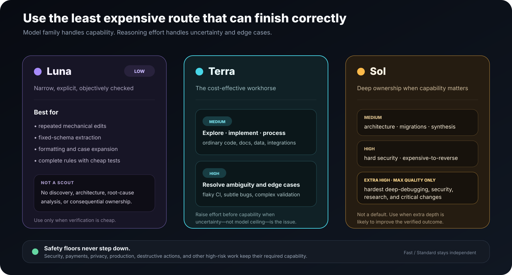

<p align="center">
  
</p>

<p align="center">
  <a href="https://github.com/vibeforge1111/Codex-Autorouter/actions/workflows/ci.yml"></a>
  
  <a href="LICENSE"></a>
  
</p>

<p align="center">
  <strong>Install it once, then use Codex normally.</strong><br>
  Autorouter chooses the model, reasoning effort, and useful subagents for each task.
</p>

---

## Start here

You do not need to learn Luna, Terra, Sol, effort levels, or agent orchestration before using Autorouter. Describe what you want built, fixed, researched, or reviewed. Autorouter handles the routing in the background.

### What you need

- Codex Desktop or Codex CLI
- Python 3.10 or newer
- Access to this GitHub repository during the private beta

### 1. Install Autorouter

No ZIP download or manual file copying is needed. Codex downloads the plugin into its own plugin cache. Open a terminal and run:

```bash
codex plugin marketplace add vibeforge1111/Codex-Autorouter --ref main
codex plugin add gpt-5-6-router@codex-autorouter
```

The second command prints an **Installed plugin root**. Copy that path—you will use it once during setup. This command-line path is recommended because it makes the location needed in step 2 explicit.

> The repository is private during beta, so installation currently requires GitHub access. When it becomes public, the same path will work for everyone.

Private-beta users should make sure Git can access the repository before installing. If you use GitHub CLI, the usual setup is:

```bash
gh auth login
gh auth setup-git
```

### 2. Turn on the model routes

Change into the installed plugin root printed above, then run:

```bash
cd "<installed plugin root>"
python3 skills/route-gpt-5-6-work/scripts/routerctl.py activate
```

This adds six Autorouter model choices to Codex. It does not replace your other agents or change your Fast/Standard preference.

### 3. Review the five Autorouter checks

Restart Codex and start a new task. If Codex asks about hooks, review and trust the five Autorouter entries. They are small local checks that keep routing and final verification in sync.

In Codex CLI, enter `/hooks` if you need to reopen the review screen.

### 4. Confirm everything is ready

From the installed plugin root, run:

```bash
python3 scripts/check_hooks.py
```

Look for:

```text
"ready": true
```

If it says `false`, follow the short [troubleshooting guide](docs/TROUBLESHOOTING.md). You do not need to interpret the full diagnostic yourself.

<p align="center">
  
</p>

## Your first task

That is it—prompt Codex normally. A good first test is:

```text
Review this project and recommend one small, useful improvement. Do not edit
files yet. Choose the best model and effort automatically, and tell me the
route in one short line before you begin.
```

You should see a simple label such as `Terra High Fast` or `Sol Medium Standard`. You can then stop thinking about model selection and focus on the work.

## Pick your optimization style

Autorouter starts in **Balanced**, the recommended setting for most people.

<p align="center">
  
</p>

| Setting | Best for | What it does |
|---|---|---|
| **Token Saver** | Routine work and tighter budgets | Uses cheaper routes when they can still finish safely |
| **Balanced** | Everyday product building | Balances quality, speed, and token use |
| **Max Quality** | Important launches and difficult problems | Uses stronger reasoning and more evidence when it is likely to help |

Change the setting from the installed plugin root:

```bash
# Pick one
python3 skills/route-gpt-5-6-work/scripts/routerctl.py profile token-saver
python3 skills/route-gpt-5-6-work/scripts/routerctl.py profile balanced
python3 skills/route-gpt-5-6-work/scripts/routerctl.py profile max-quality

# See the current setting
python3 skills/route-gpt-5-6-work/scripts/routerctl.py profile
```

The choice is remembered across updates and applies to your next new task.

## Fast and Standard

Fast/Standard is a Codex speed preference. It is separate from Token Saver, Balanced, and Max Quality.

- **Fast:** choose it when you want shorter waits and accept higher credit use.
- **Standard:** choose it when saving credits matters more than response time.
- **Autorouter never switches this setting for you.** Every selected model and subagent inherits your current choice.

In Codex Desktop, use the visible Fast control. In Codex CLI, use:

```text
/fast on
/fast off
/fast status
```

If you turn Fast on, a route can appear as `Terra High Fast`. Turn it off and new work will use Standard, such as `Terra High Standard`. If your current Codex model or account does not offer Fast, Codex simply keeps Standard available.

**A useful default:** keep Balanced + Standard for normal background work. Turn Fast on for interactive building sessions. Use Max Quality when the outcome matters more than speed or token use.

See the official [Codex speed guide](https://learn.chatgpt.com/docs/agent-configuration/speed) for current Fast availability and credit behavior.

## What Autorouter chooses

<p align="center">
  
</p>

- **Luna** handles clear, repetitive work that is easy to check.
- **Terra** handles most building, exploration, testing, and debugging.
- **Sol** handles architecture, difficult decisions, deep debugging, and high-impact work.

You do not need to request one by name. Autorouter chooses per task—and can choose differently for separate parts of a larger project.

## When subagents help

<p align="center">
  
</p>

Small tasks stay in one agent. Larger tasks may split into a few independent pieces, or gather evidence before one agent owns the final result. Autorouter keeps this bounded so a simple request does not turn into an expensive swarm.

## Tips for better results

1. **Describe the outcome, not the model.** Say what you want built or fixed; let Autorouter choose Luna, Terra, or Sol.
2. **Include “done when.”** Mention the test, behavior, or visible result that should prove completion.
3. **Start with Balanced.** Move to Token Saver or Max Quality only when you have a reason.
4. **Use Fast for active collaboration.** Standard is a good default for work that can run in the background.
5. **Start a new task after setup or profile changes.** New tasks pick up the latest plugin instructions and preference cleanly.
6. **Ask when you are curious.** “Show me the route and why in one line” gives you the model, effort, speed, and plan without a technical dump.
7. **Let verification finish.** The cheapest successful run is the one that does not need to be redone.

## What Autorouter will—and will not—do

- It chooses a cost-effective GPT-5.6 route for each task.
- It can use a small number of specialized subagents when they materially help.
- It keeps important work on appropriately capable routes, even in Token Saver.
- It verifies file-changing work before reporting success.
- It does not change your Fast/Standard preference.
- It does not store your prompt text or a hash of it in its routing records.

## Update or remove Autorouter

For updates, reinstall from the marketplace, run `routerctl.py activate` again from the new installed root, then restart Codex and begin a new task. Your optimization profile is preserved.

For step-by-step update, repair, and removal instructions, use the [installation and lifecycle guide](docs/INSTALL.md).

## Help and deeper documentation

| Guide | Use it when |
|---|---|
| [Installation and lifecycle](docs/INSTALL.md) | You are installing, updating, repairing, or removing Autorouter |
| [Troubleshooting](docs/TROUBLESHOOTING.md) | The readiness check does not say `true` |
| [Privacy](docs/PRIVACY.md) | You want to know what local routing data is stored |
| [Known limitations](docs/LIMITATIONS.md) | You want exact runtime and platform boundaries |
| [Standalone advisory mode](docs/STANDALONE.md) | You are using a surface without full plugin support |

<details>
<summary><strong>Developer and release details</strong></summary>

### How routing works

<p align="center">
  
</p>

Autorouter profiles the task, selects one route and bounded plan, executes it directly or through depth-1 agents, and verifies the final result. It permits at most three subagents and one evidence-backed route-up.

### Local verification

```bash
PYTHONDONTWRITEBYTECODE=1 python3 scripts/validate_release.py
PYTHONDONTWRITEBYTECODE=1 python3 scripts/fuzz_router.py

cd skills/route-gpt-5-6-work/scripts
PYTHONDONTWRITEBYTECODE=1 python3 -m unittest -v test_router test_routerctl

cd ../../../scripts
PYTHONDONTWRITEBYTECODE=1 python3 -m unittest -v test_check_hooks test_standalonectl

cd ..
PYTHONDONTWRITEBYTECODE=1 python3 -m unittest -v benchmarks.test_autorouter_bench
```

The release gate covers 200 routing, lifecycle, and benchmark tests plus 5,000 deterministic fuzz cases on every hosted Python and operating-system combination. See [release evidence](docs/RELEASE_EVIDENCE.md), the [release checklist](docs/RELEASE_CHECKLIST.md), and [Autorouter Arena](benchmarks/README.md) for the full proof and benchmark method.

</details>

## License

[MIT](LICENSE)
