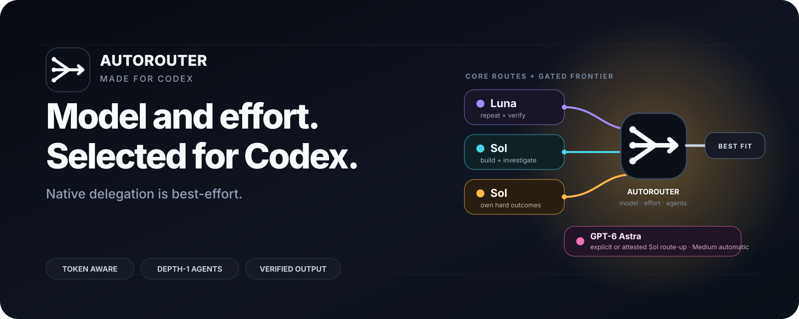
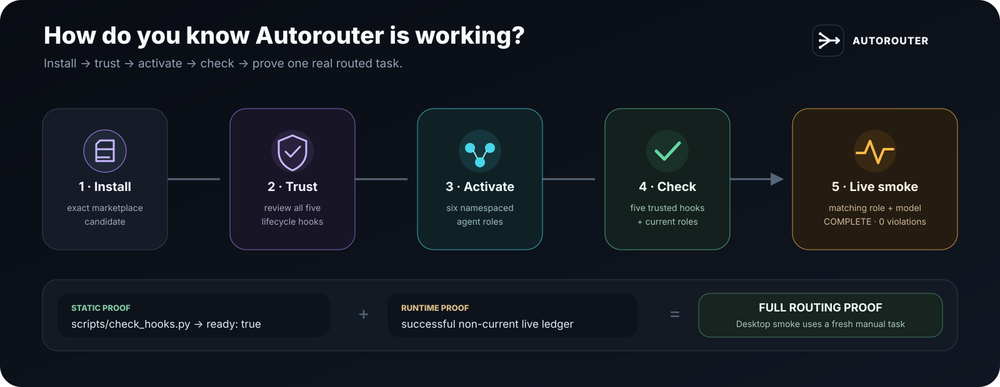

<p align="center">
  
</p>

<p align="center">
  <a href="https://github.com/vibeforge1111/Codex-Autorouter/actions/workflows/ci.yml"></a>
  
  <a href="LICENSE"></a>
  
</p>

<p align="center">
  <strong>Automatic model, effort, and subagent routing for Codex.</strong><br>
  Spend tokens where they improve the verified result—not everywhere by default.
</p>

---

## What Autorouter does

Autorouter profiles each task, chooses the least expensive GPT-5.6 route likely to finish it correctly, and requires proportionate evidence before completion. It can keep work in the current agent or delegate bounded units to Luna, Terra, or Sol with an appropriate configured reasoning effort.

- **Understands the work:** risk, ambiguity, product area, volume, mutation scope, verification strength, and safe parallelism.
- **Routes the whole plan:** model family, reasoning effort, Fast/Standard inheritance, subagent shape, and verification gate.
- **Optimizes total cost:** context handoffs and retries count too; the cheapest request is not always the cheapest correct outcome.

Public labels stay factual: `Terra High Standard`, `Sol Extra High Fast`, or `Luna Low Speed unknown`. Autorouter never invents live model, effort, or speed evidence that Codex did not expose.

## Which model gets used

<p align="center">
  
</p>

Luna is not the scouting model. It is reserved for narrow, explicit, low-consequence work with cheap objective checks. Terra handles most exploration, implementation, processing, and ambiguous debugging. Sol owns architecture, migrations, demanding synthesis, difficult security, and other consequential work. Extra High is a narrow Max Quality route—not a blanket default.

The router understands strategy, requirements, UX, frontend, backend, databases, mobile, AI, integrations, payments, QA, analytics, growth, accessibility, localization, DevOps, reliability, security, privacy, performance, launch, and maintenance. Each work unit is routed independently.

## Three optimization profiles

<p align="center">
  
</p>

Set the persistent preference from the installed plugin directory:

```bash
python3 skills/route-gpt-5-6-work/scripts/routerctl.py profile token-saver
python3 skills/route-gpt-5-6-work/scripts/routerctl.py profile balanced
python3 skills/route-gpt-5-6-work/scripts/routerctl.py profile max-quality
```

Inspect it with:

```bash
python3 skills/route-gpt-5-6-work/scripts/routerctl.py profile
```

The preference survives plugin upgrades and applies to the next new task. Fast/Standard remains a separate Codex setting: Autorouter inherits it and never silently toggles it.

## Subagents without sprawl

<p align="center">
  
</p>

Small work stays direct. Independent units can fan out to bounded Luna or Terra leaves. Consequential work can gather evidence with Terra before one Sol agent owns the outcome. Advisors are read-only and do not form a separate judge layer; the root agent verifies coverage, resolves conflicts, and accepts or rejects the result.

Hard limits remain simple: depth 1, at most three agents, and at most one evidence-backed route-up per turn.

## How routing works

<p align="center">
  
</p>

1. **Profile** trusted user intent and current task state.
2. **Select** one capability route and one bounded orchestration plan.
3. **Execute** directly or through exact depth-1 custom-agent roles.
4. **Verify** after the final mutation with the cheapest relevant deterministic evidence.
5. **Route up once** only when completed work demonstrates a real capability limit.

## Install and prove readiness

<p align="center">
  
</p>

### Marketplace plugin — full routing and hooks

The public plugin is **Autorouter**. Its technical package ID remains `gpt-5-6-router` so existing private-beta installs, preferences, and upgrade paths are not stranded.

```bash
codex plugin add gpt-5-6-router@<marketplace>

python3 skills/route-gpt-5-6-work/scripts/routerctl.py status
python3 skills/route-gpt-5-6-work/scripts/routerctl.py activate
python3 scripts/check_hooks.py
```

Review the five lifecycle hooks when Codex prompts. In the CLI/TUI, `/hooks` reopens the review screen. Plugin installation does not imply hook trust. Python 3.10 or newer is required.

`scripts/check_hooks.py` must report `ready: true`, exactly five trusted hooks, the exact cached skill version, and six current custom-agent definitions. One successful non-current live ledger with matching lifecycle attestation is the final runtime proof.

### GitHub archive — standalone advisory mode

Codex IDE extensions do not currently load plugins. A release archive can instead install the conflict-safe advisory skill:

```bash
python3 scripts/standalonectl.py status
python3 scripts/standalonectl.py install
```

Standalone mode deliberately does not claim plugin-hook enforcement. See [standalone installation](docs/STANDALONE.md) and [known limitations](docs/LIMITATIONS.md).

## Safety by design

- **Bounded delegation:** maximum depth 1 and maximum three agents.
- **Protected floors:** Token Saver never discounts security, payments, privacy, production, destructive actions, or other high-risk work.
- **No silent speed changes:** Fast/Standard is inherited, not selected by Autorouter.
- **Post-mutation verification:** the root agent remains responsible for checking the final mutated state; verification debt is recorded without interrupting Stop.
- **Lifecycle-safe escalation:** delayed sibling completion is reconciled before staged execution, and route-up is limited to real task-capability ceilings—not hidden metadata or obsolete cache paths.
- **Session-safe completion:** Stop and SubagentStop are advisory-only, record unmet gates as `FAILED_OPEN`, and never emit a replayable hard-block message; duplicate terminal events are idempotent.
- **Upgrade-resilient hooks:** open tasks can locate the newest installed cache after their original immutable cache is replaced.
- **Conflict-safe activation:** only six namespaced agent files are managed, with checksums, atomic replacement, rollback, crash recovery, and legacy-role migration.
- **Prompt privacy:** routing ledgers contain no prompt content or prompt-derived hashes.

## Honest readiness states

| State | Meaning |
|---|---|
| `ADVISORY` | The skill can advise or work in the current agent; full enforcement is not proven. |
| `ADVISORY` + `local_agent_ready: true` | Agent definitions are current, but filesystem state cannot attest hook discovery. |
| `scripts/check_hooks.py` → `ready: true` | App-server discovery, trusted hooks, and current agent files match this build. |
| Successful non-current live ledger | Codex actually selected the required custom role and model. |
| `MANAGED_BLOCKED` | Organization policy permits only managed hooks; Autorouter does not bypass it. |

> **Release status:** the automated matrix passes on macOS, Ubuntu, and Windows across Python 3.10–3.14. Broad public-stable release still requires the remaining real-host acceptance rows and a tested private vulnerability-reporting channel after the repository becomes public. See [release evidence](docs/RELEASE_EVIDENCE.md).

## Documentation

| Guide | Use it for |
|---|---|
| [Installation and lifecycle](docs/INSTALL.md) | Plugin install, activation, upgrade, repair, and uninstall |
| [Standalone advisory mode](docs/STANDALONE.md) | GitHub archive and IDE-compatible installation |
| [Known limitations](docs/LIMITATIONS.md) | Runtime, hooks, Fast, and custom-agent boundaries |
| [Privacy](docs/PRIVACY.md) | Local preference and ledger contents |
| [Troubleshooting](docs/TROUBLESHOOTING.md) | Readiness, trust, recovery, and routing-profile issues |
| [Upstream hook replay report](docs/UPSTREAM_CODEX_HOOK_REPLAY_BUG.md) | Reproduction and required Codex-side fix for poisoned terminal-hook messages |
| [Real-host acceptance](docs/HOST_ACCEPTANCE.md) | Exact release smoke procedure |
| [Release checklist](docs/RELEASE_CHECKLIST.md) | Automated and public-launch gates |
| [Release evidence](docs/RELEASE_EVIDENCE.md) | Candidate-specific validation proof |

## Development

```bash
PYTHONDONTWRITEBYTECODE=1 python3 scripts/validate_release.py
PYTHONDONTWRITEBYTECODE=1 python3 scripts/fuzz_router.py

cd skills/route-gpt-5-6-work/scripts
PYTHONDONTWRITEBYTECODE=1 python3 -m unittest -v test_router test_routerctl

cd ../../../scripts
PYTHONDONTWRITEBYTECODE=1 python3 -m unittest -v test_check_hooks test_standalonectl

cd ..
PYTHONDONTWRITEBYTECODE=1 python3 -m unittest -v benchmarks.test_autorouter_bench
```

The current suite covers 199 routing, lifecycle, and benchmark-harness tests plus 5,000 deterministic fuzz cases per CI job, including all three profiles, Extra High selection, delegated-input isolation, repeated-role collaboration reconciliation, stale-cache migration, terminal-hook poison prevention and offline repair, nested-tool verification, unobservable-result fail-open behavior, wrapped Stop-feedback idempotency, lifecycle ownership, concurrency, crash recovery, hook readiness, clean-room standalone installation, frozen capability-fixture validation, profile restoration, and end-to-end blind-panel claim boundaries.

### Capability and efficiency benchmark

Unit tests prove routing policy; they do not prove that routing improves a real
task. [Autorouter Arena](benchmarks/README.md) runs frozen product-building
cases against plain Codex, Token Saver, Balanced, and Max Quality from identical
starters, then reports outcome quality, actual routing/subagent evidence,
tokens, and elapsed time separately. An optional private GLM 5.2 + DeepSeek V4
Pro blind panel can provide separated qualitative review during development;
that reviewer machinery is not part of the runtime plugin.

```bash
python3 benchmarks/autorouter_bench.py route-audit
python3 benchmarks/autorouter_bench.py prepare --output /tmp/autorouter-arena
```

Paid A/B runs require explicit execution and reviewed-hook acknowledgements;
the benchmark never spends tokens by default.

## License

[MIT](LICENSE)
