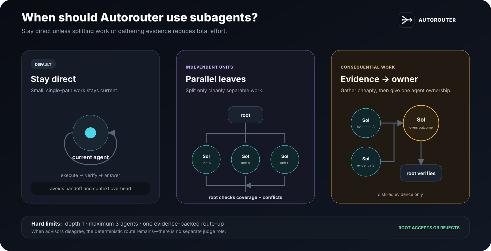

<p align="center">
  
</p>

## v0.3.0 preview: user-configured AI routing

The [v0.3.0 prerelease](https://github.com/anthonypaddison/codex-autorouter/releases/tag/v0.3.0)
adds opt-in API classification. Legacy routing remains available before setup.
See the [installation guide](docs/INSTALL.md) and the
[v1.0.0 release gates](docs/STABLE_READINESS.md).

**Runtime status: LIMITED CLI ACCEPTANCE PASSED.** The installed v0.3.0 trial
automatically classified one Luna/Low task and completed one correlated
Terra/Medium child with zero violations. The accepted payload was
`sha256:46a2e7837fad421bc95ee545de509fadb9f4534162267735f6fa5dfa20754448`.
Later timeout/setup finalisation is regression-tested, not automatically deployed
or covered by a repeated live test. This does not prove Desktop credential
inheritance, routing quality across workloads, or savings. See the
[limited-trial operator guide](docs/TRIAL.md) for activation, metrics and rollback.

Configured mode uses the OpenAI Responses
API, not a nested Codex CLI. It explicitly disables model tools, validates the
selection against the configured allowlist and asks Codex to validate the child
model/effort natively before spawning. Configuration is not execution proof.
Unconfigured legacy routing is unchanged. Do not promote this candidate on the
strength of mocked tests alone.

After a separately reviewed installation of this candidate, run the setup
command from that plugin's root:

```sh
python3 scripts/autorouter.py models
python3 scripts/autorouter.py setup
python3 scripts/autorouter.py status
```

The wizard shows advisory Codex executor catalogue entries, then asks separately
for the API provider (`openai`), API classifier model/effort, credential environment
variable **name**, executor models/efforts, fallback and explicit billing opt-in.
API model identifiers are not Codex executor capabilities. The provider/model
must support Responses, strict JSON-schema output and the configured reasoning
effort. An absent/stale Codex catalogue does not prevent entering explicit pairs;
Codex rejects unsupported requests before child creation where its native
validation applies. The router never bypasses those restrictions.

Without an interactive terminal, use the equivalent flags, replacing identifiers
with exact values from `models`:

```sh
python3 scripts/autorouter.py setup \
  --provider openai --classifier API_CLASSIFIER_ID --classifier-effort CLASSIFIER_EFFORT \
  --credential-env AUTOROUTER_OPENAI_API_KEY --enabled \
  --allow CURRENT_ROOT_ID=CURRENT_ROOT_EFFORT \
  --allow SMALL_ID=SMALL_EFFORT \
  --allow LARGE_ID=MEDIUM_EFFORT,HIGH_EFFORT \
  --fallback LARGE_ID=HIGH_EFFORT --timeout-seconds 10
```

Include the actual root model/effort to permit stay-current execution when the
classifier selects it. If that model is already listed, add the effort to its
existing entry rather than duplicating the model. An exact selected root pair
stays direct; a different pair still requires native Codex validation and a
permitted child. The wizard does not force a different model or infer the root
from global defaults. Explicit supported model preferences remain enforced.

New setup defaults to a ten-second total classifier deadline; `--timeout-seconds`
and the wizard support 1–30 seconds. Existing configured deadlines remain intact
until explicit reconfiguration. UserPromptSubmit has a 35-second outer deadline;
other hooks retain their existing limits. No automatic retry is added.

Setup writes only `CODEX_HOME/autorouter/config.json` (normally under `~/.codex`),
or the explicit `--config` path for offline preparation. Repeating setup makes a
byte-exact backup before replacement. It does not install plugins, log in,
modify Codex defaults, run inference or verify model entitlement. Use `--disabled`
instead of `--enabled` to keep configured AI routing inactive. Reconfigure with
the same command; reinstalling is unnecessary. Schema-v1 CLI-era configurations
remain readable but require explicit setup before API usage; no automatic
conversion can silently start API spending.

Provision the referenced environment variable in the process that starts Codex;
Desktop must inherit it. Never paste the key into setup, task text, JSON config,
Git or logs. The router reads only that explicitly referenced API credential,
never saved Codex/ChatGPT authentication. Requests use API-account billing/credits,
not the signed-in Codex allowance. No credential is provisioned by setup.

Classification sends only the supplied task and allowlist, with a 32 KiB task
limit, 256 output-token cap, 128 KiB response bound and a configurable 1–30 second
deadline (ten seconds by default for new setup).
A short-lived standard-library Python HTTP worker makes one HTTPS request; it
does not run Codex, hooks or tools. There are no automatic API retries, redirects,
proxies, repository scans or new dependencies. Failures may select only the
configured fallback before execution starts. No fallback is automatically spawned
after a delegation rejection, uncertain result or child failure.

The owned turn ledger is reserved before classification. Duplicate delivery,
including after an interrupted request with unknown billing outcome, cannot
repeat it. Simple continuations reuse the decision without spawning the assignment
again; use existing child evidence rather than duplicating possibly completed work.

For a directly enforced preference, start a prompt with:

```text
Use model EXACT_MODEL_ID at EXACT_EFFORT effort.
```

That model/effort must be permitted by the configured allowlist;
otherwise routing reports unavailable rather than silently choosing another
model. An omitted effort uses the first effort explicitly selected during setup.
This exact directive skips the classifier. An exact observed root pair stays
current; otherwise one explicit native-validated child is requested. Other
natural-language preferences are classifier input, not a deterministic override.

The existing root cannot be changed by this plugin. A catalogue listing or
configuration entry is not proof that the host's child tool accepts that model.
Status reports `codex_native_validation`, not preverified execution. Known native
preparation errors are recorded as rejection before creation; generic errors
without start evidence retain an unknown creation boundary. A returned child ID
alone is not lifecycle completion. Existing correlation, attestation and
verification gates remain intact. Configuration changes during an in-flight task
invalidate reuse of its old routing contract.

Classifier elapsed time, invocation attempts and observed token usage are
recorded separately from executor evidence. Missing token telemetry is unknown,
not zero. Real latency, classifier quality, account access and financial savings
require a separately authorised live evaluation with explicitly provisioned API
credentials and a verifiable spending ceiling; mocked tests cannot establish them. See
[limitations](docs/LIMITATIONS.md) and [privacy](docs/PRIVACY.md).

## Legacy deterministic routing reference

The remaining routing diagrams, profiles and policy examples describe the legacy
v0.2-compatible deterministic mode, not configured AI classification. They are
retained for existing users. New users should start with the configured-mode
setup above and the [installation guide](docs/INSTALL.md). Configured mode does not
inherit the legacy fixed-family ladder, three-child plans or frontier gates;
only the user's exact allowlist and native Codex restrictions apply.

<p align="center">
  <a href="https://github.com/anthonypaddison/Codex-Autorouter/actions/workflows/ci.yml"></a>
  
  <a href="LICENSE"></a>
  
</p>

<p align="center">
  <strong>Select Luna once, then use Codex normally.</strong><br>
  Autorouter keeps routine work on the active root and escalates bounded work only when warranted.
</p>

---

## Start here

Autorouter is designed around a cheap GPT-6 Luna root. Describe what you want built, fixed, researched, or reviewed; the active root remains authoritative for the turn and Autorouter escalates only when the task warrants it.

### What you need

- Codex Desktop or Codex CLI
- Python 3.10 or newer
- Git with access to public GitHub repositories

### 1. Select Luna once

In Codex Desktop, select **GPT-6 Luna** as the model before starting a new task. For a personal CLI default, use these top-level entries in your Codex `config.toml`:

```toml
model = "gpt-6-luna"
model_reasoning_effort = "low"
```

`low` is the preferred initial effort, not an architectural requirement. If a later controlled acceptance test shows that Luna Low is unreliable at following routing instructions, creating bounded child contracts, or synthesising escalated results, compare Luna Low with Luna Medium before changing the recommendation.

This is a one-time user selection. Autorouter does not configure Luna, does not silently modify the root model, and none of its install, update, activate, deactivate, or remove operations changes global/root Codex configuration.

Existing GPT-6.1 Sol and GPT-6.1 Terra roots are also supported. Autorouter retains the exact root model and uses that same model for approved effort increases and independent workers; it never silently switches a GPT-6.1 root to GPT-6 Sol. Luna's default escalation target remains GPT-6 Sol. A supported non-Luna root still reports reduced credit efficiency, separately from execution capability.

### 2. Install the reviewed release

Install the published `v0.3.0` prerelease by its pinned tag:

```bash
codex plugin marketplace add anthonypaddison/Codex-Autorouter --ref v0.3.0
codex plugin add gpt-5-6-router@codex-autorouter
```

The second command prints an **Installed plugin root**. Copy that path for the health check. The immutable tag prevents an existing marketplace entry from silently changing underneath an installation.

### 3. Review the six Autorouter checks

Restart Codex and start a new task. If Codex asks about hooks, review and trust the six Autorouter entries. The `PreToolUse` hook checks native spawn arguments against the current configured turn before child creation. An invalid call is denied and should not be retried. Child attestation still requires separate start and completion evidence.

In Codex CLI, enter `/hooks` if you need to reopen the review screen.

### 4. Confirm everything is ready

From the installed plugin root, run:

```bash
python3 scripts/check_hooks.py
```

The command returns one of three top-level health states:

- `READY`: GPT-6 Luna is the observed root for the current task and at least one model-keyed, non-stale receipt proves a successful GPT-6 Sol or Astra escalation through the same plugin candidate and versioned Codex runtime/build identity.
- `DEGRADED`: Autorouter remains usable, but the active root was not Luna or current escalation capability is not proven. When the root is not Luna, credit-saving behaviour will be substantially reduced.
- `UNAVAILABLE`: the supported hooks or direct child-routing path cannot operate.

The hook's `UserPromptSubmit.model` is authoritative for every actual turn. Desktop, app-server, and config evidence can explain health, but cannot override that active-model evidence. Follow the [troubleshooting guide](docs/TROUBLESHOOTING.md) for any state other than `READY`.

Root reasoning effort prefers a valid authoritative hook field. When omitted, root-evidence acquisition performs one immediate lookup of the hook-provided transcript, bound to the exact session and turn. It reuses descriptor-validated JSONL reading with an 8 MiB total I/O budget and a 16 MiB individual-line limit; large transcripts use the session header and complete tail records, never partial JSON. Recovered effort is recorded as `exact_turn_context`, separately from child configuration intent. Missing, conflicting, malformed, unsafe, or insufficiently bounded evidence remains unknown/unproven; configuration never proves runtime effort. There are no sleeps, polling, or retries, and no prompt content or transcript path is persisted by this lookup.

Readiness receipts are earned only after an expected child is observed on the exact requested GPT-6 Sol or Astra model and the same `agent_id` completes successfully. Receipts are stored by model tier, so one tier's proof cannot silently attest another. The exact bounded child transcript may supply authoritative model, effort, and turn evidence when Desktop omits a child prompt hook; missing, contradictory, malformed, or oversized evidence creates no receipt. Receipts bind the plugin content identity, plugin version, Codex runtime/build where exposed, Desktop or CLI host type, platform, observed child model, effort intent, capability/schema signature, and timestamp. At least one matching versioned runtime/build identifier is mandatory for `READY`; null never matches null. Identity-null receipts remain visible as `ESCALATION PREVIOUSLY OBSERVED` but cannot establish current-runtime capability. Receipts expire for readiness after 30 days but remain available as history. A runtime/build or plugin-candidate change invalidates `READY` until normal work produces a fresh successful receipt; the health check never launches an automatic paid probe.

Child lifecycle translation uses the current GPT-6 profiles, not historical agent names. Exact parent-turn/spawn-call/child evidence preserves the requested model, effort and profile in the parent ledger. Model-only events cannot distinguish multiple same-model profiles; insufficient or contradictory binding stays unproven and grants no completion credit. A lifecycle binding failure is not a technical capability limit and must not trigger `ROUTE_UP`.

## Your first task

When hook inputs omit runtime identity, Autorouter can recover the Codex version and host type from the first metadata record of the hook-supplied transcript. The read is limited to 64 KiB, rejects linked paths, and requires an exact session match and a recognised host. Explicit hook runtime identity takes precedence. New capability receipts include validated model/profile/effort policy evidence; old receipts missing that evidence remain unproven and are never silently upgraded.

Automation hook delivery is host/version dependent. The currently observed Codex Desktop host dispatches Autorouter hook context and ledgers for automation-triggered turns, but Autorouter has not validated automation routing semantics as a supported savings surface. Continue excluding automation activity from Autorouter-attributable savings until that support is explicitly validated. See [supported surfaces and real-host coverage](docs/LIMITATIONS.md#supported-surfaces-and-real-host-coverage).

That is it—prompt Codex normally. A good first test is:

```text
Review this project and recommend one small, useful improvement. Do not edit
files yet. Choose the best model and effort automatically, and tell me the
route in one short line before you begin.
```

You should see a simple label such as `Sol High Fast` or `Sol Medium Standard`. You can then stop thinking about model selection and focus on the work.

## Pick your optimization style

Autorouter starts in **Balanced**, the recommended setting for most people.

<p align="center">
  
</p>

| Setting | Best for | What it does |
|---|---|---|
| **Token Saver** | Routine work and tighter budgets | Uses cheaper routes when they can still finish safely |
| **Balanced** | Everyday product building | Balances quality, speed, and token use |
| **Max Quality** | Important launches and difficult problems | Uses stronger reasoning and more evidence when it is likely to help |

Change the setting from the installed plugin root:

```bash
# Pick one
python3 skills/route-gpt-5-6-work/scripts/routerctl.py profile token-saver
python3 skills/route-gpt-5-6-work/scripts/routerctl.py profile balanced
python3 skills/route-gpt-5-6-work/scripts/routerctl.py profile max-quality

# See the current setting
python3 skills/route-gpt-5-6-work/scripts/routerctl.py profile
```

The choice is remembered across updates and applies to your next new task.

## Fast and Standard

Fast/Standard is a Codex speed preference. It is separate from Token Saver, Balanced, and Max Quality.

- **Fast:** choose it when you want shorter waits and accept higher credit use.
- **Standard:** choose it when saving credits matters more than response time.
- **Autorouter never switches this setting for you.** Every selected model and subagent inherits your current choice.

In Codex Desktop, change Fast/Standard from the visible UI control. Typing `/fast on` or `/fast off` into a task does not change the Desktop setting; Autorouter cannot toggle it from a prompt.

If you turn Fast on in the UI, the next routed request can appear as `Sol High Fast`. Turn it off in the UI and the route will use Standard, such as `Sol High Standard`. If your current Codex model or account does not offer Fast, Codex simply keeps Standard available.

**A useful default:** keep Balanced + Standard for normal background work. Turn Fast on for interactive building sessions. Use Max Quality when the outcome matters more than speed or token use.

See the official [Codex speed guide](https://learn.chatgpt.com/docs/agent-configuration/speed) for current Fast availability and credit behavior.

## What Autorouter chooses

<p align="center">
  
</p>

The model reported by `UserPromptSubmit.model` determines what is allowed for that turn:

| Active root | Routine work | Normal work | Hard work | Credit health |
|---|---|---|---|---|
| **GPT-6 Luna Low** | Stay on Luna | May escalate to GPT-6 Sol Medium | May escalate to GPT-6 Sol High | Efficient root; eligible for `READY` |
| **GPT-6 Sol Medium** | Stay on Sol | Stay on Sol | May escalate to GPT-6 Sol High; Astra only through an explicit request or attested `ROUTE_UP` | `DEGRADED` for the turn |
| **GPT-6 Sol High/xHigh** | Stay on Sol | Stay on Sol | Stay on Sol; Astra only through an explicit request or attested `ROUTE_UP` | `DEGRADED` for the turn |
| **GPT-6 Astra** | Stay on Astra | Stay on Astra | Stay on Astra | `DEGRADED` for the turn |

Sol and Astra are never delegated downward merely to satisfy the classifier. Independent parallel work may still justify same-capability Sol children when each has its own bounded workstream. User-intent ambiguity does not justify a stronger model: Luna asks one concise clarification. Technical uncertainty inside an otherwise clear task may justify GPT-6 Sol Medium or High.

Astra is deliberately rare. Generic task severity, frontier-sounding keywords, and Max Quality do not select it. An explicit request supports Astra Medium, High, Extra High, or Max and defaults to Medium when unqualified; explicit Low and Ultra are rejected. The only automatic path is an authoritative, same-task, successfully attested Sol `ROUTE_UP`, and it always requests Astra Medium. There are no automatic Astra effort retries.

## When subagents help

<p align="center">
  
</p>

Small tasks stay in one agent. Larger tasks may split into a few independent pieces, or gather evidence before one agent owns the final result. Autorouter keeps this bounded so a simple request does not turn into an expensive swarm.

## Tips for better results

1. **Describe the outcome, not the model.** Say what you want built or fixed; let Autorouter choose GPT-6 Luna or Sol. Request Astra explicitly only when you intentionally want the frontier tier.
2. **Include “done when.”** Mention the test, behavior, or visible result that should prove completion.
3. **Start with Balanced.** Move to Token Saver or Max Quality only when you have a reason.
4. **Use Fast for active collaboration.** Standard is a good default for work that can run in the background.
5. **Start a new task after setup or profile changes.** New tasks pick up the latest plugin instructions and preference cleanly.
6. **Ask when you are curious.** “Show me the route and why in one line” gives you the model, effort, speed, and plan without a technical dump.
7. **Let verification finish.** The cheapest successful run is the one that does not need to be redone.

## What Autorouter will—and will not—do

- It chooses a cost-effective GPT-6 Luna or Sol route for each task and exposes Astra only through its narrow frontier gate.
- It can use a small number of specialized subagents when they materially help.
- It keeps important work on appropriately capable routes, even in Token Saver.
- It verifies file-changing work before reporting success.
- It treats bundled legacy custom-agent TOMLs as optional compatibility material. Their absence does not reduce health, and normal installation or activation does not install them.
- It does not change your Fast/Standard preference.
- It never changes or claims to have configured your root model.
- It never spends credits on an automatic readiness probe.
- New routing records do not store your prompt text or a hash of it. Affected historical ledgers may retain legacy prompt-derived event keys until normal retention or an explicit purge removes them; see the [privacy guide](docs/PRIVACY.md).

## Update or remove Autorouter

For updates, reinstall the reviewed immutable marketplace version, then restart Codex and begin a new task. Your optimization profile and user-selected root remain separate from plugin lifecycle behaviour.

Legacy custom-agent TOMLs are retained only for compatibility testing or an explicit legacy mode. Do not enable that mode as part of a normal install or update.

Use the health check after an update. Removal must not change the user-selected root model.

## Help and deeper documentation

| Guide | Use it when |
|---|---|
| [Troubleshooting](docs/TROUBLESHOOTING.md) | The readiness check does not say `READY` |
| [Release procedure](docs/RELEASING.md) | You are preparing a reviewed immutable tag, archive, and checksum |
| [Privacy](docs/PRIVACY.md) | You want to know what local routing data is stored |
| [Known limitations](docs/LIMITATIONS.md) | You want exact runtime and platform boundaries |
| [Standalone advisory mode](docs/STANDALONE.md) | You intentionally need the legacy compatibility path on a surface without plugin support |

<details>
<summary><strong>Developer and release details</strong></summary>

### How routing works

<p align="center">
  
</p>

Autorouter profiles the task, selects one route and bounded plan, executes it directly or through depth-1 agents, and verifies the final result. It permits at most three subagents and one evidence-backed route-up; only an attested Sol route-up may enter automatic Astra Medium.

### Local verification

```bash
PYTHONDONTWRITEBYTECODE=1 python3 scripts/validate_release.py
PYTHONDONTWRITEBYTECODE=1 python3 scripts/fuzz_router.py

cd skills/route-gpt-5-6-work/scripts
PYTHONDONTWRITEBYTECODE=1 python3 -m unittest -v test_spawn_compat test_router test_routerctl test_ai_routing test_model_policy

cd ../../../scripts
PYTHONDONTWRITEBYTECODE=1 python3 -m unittest -v test_check_hooks test_standalonectl test_validate_release test_model_catalogue

cd ..
PYTHONDONTWRITEBYTECODE=1 python3 -m unittest -v benchmarks.test_autorouter_bench
```

The release gate covers the repository-defined routing, lifecycle, release-contract, and benchmark suites plus 5,000 deterministic fuzz cases. See [release evidence](docs/RELEASE_EVIDENCE.md), the [release checklist](docs/RELEASE_CHECKLIST.md), and [Autorouter Arena](benchmarks/README.md) for the full proof and benchmark method.

Live benchmark execution and grading are disabled: generated code must never be
graded by unrestricted host Python. Offline fixture generation, deterministic
route auditing and mocked tests remain available. External review is optional,
separately billable and restricted to explicitly authorised benchmark artifacts;
it is not part of installation or normal routing.

</details>

## License

[MIT](LICENSE)
